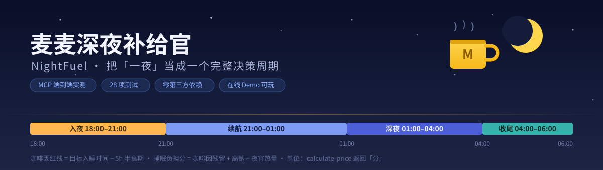
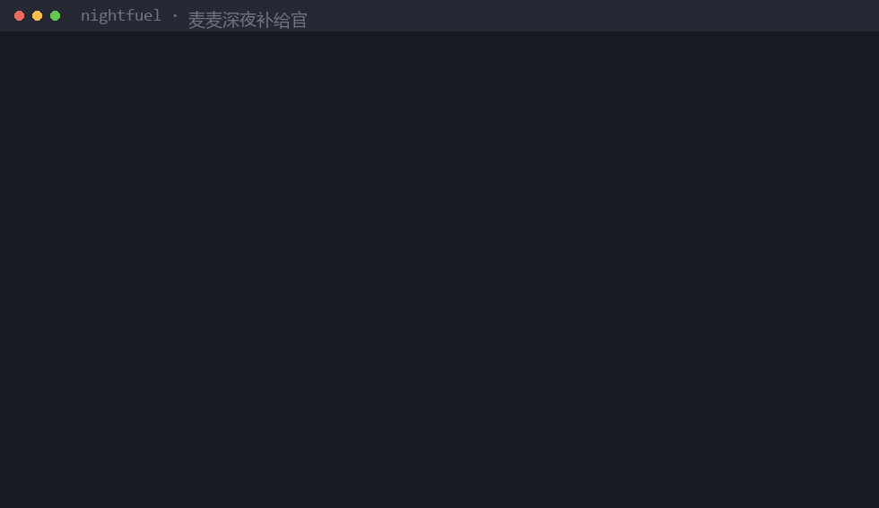
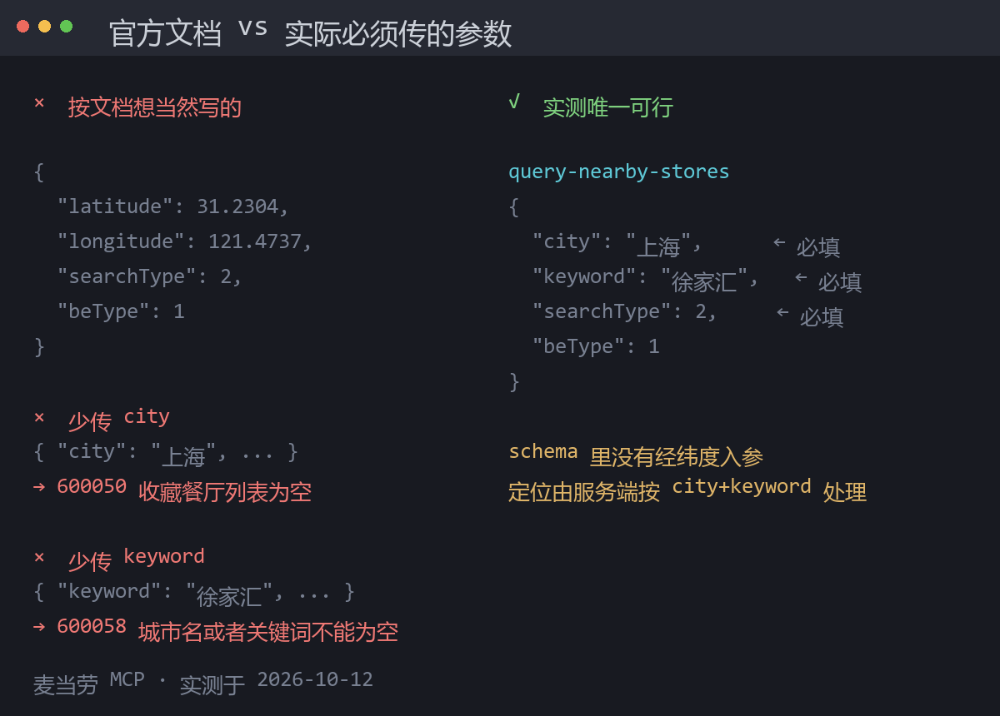
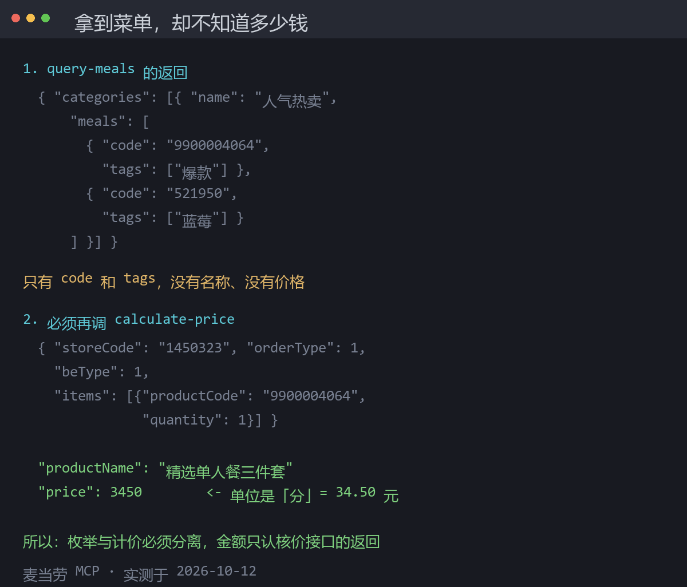

# 麦麦深夜补给官 · NightFuel



> 一个给夜班人群用的麦当劳 Skill：把「一夜」当成一个完整决策周期，而不是点一餐。

[](https://github.com/lilyco-42/mcd-nightfuel/actions/workflows/tests.yml)
[](LICENSE)


🌐 **在线体验（无需安装，30 秒看懂）**：https://lilyco-42.github.io/mcd-nightfuel/

## 30 秒快速体验

| 你想 | 命令 |
|---|---|
| 不装任何东西，浏览器玩 | 打开 <https://lilyco-42.github.io/mcd-nightfuel/>，拖动时间滑块看四阶段裁决 |
| 本地看真实链路输出（零配置、零 Token） | `git clone` 后 `python demo.py`——读 `fixtures/` 里凌晨录制的真实 MCP 响应 |
| 验证引擎没水分 | `python -m unittest discover -s tests -v`——28 个测试全绿 |

```bash
git clone https://github.com/lilyco-42/mcd-nightfuel.git
cd mcd-nightfuel
python demo.py     # 4 步：定位营业门店 → 咖啡因红线 → 今夜补给包 → 真实核价
```

## 30 秒看懂

凌晨一点半，你还要再撑三小时。NightFuel 给出的不是「最便宜的套餐」，而是**这一夜怎么排**：

| 它回答 | 怎么算 |
|---|---|
| 现在该吃什么 | `now-time-info` 判阶段 → `query-meals` 确认此刻真实在售 |
| 这家店还开着吗 | `businessStatus` 营业状态字段——而不是一句 `600057` 错误码 |
| 咖啡还能不能喝 | 目标入睡时间 − 半衰期 5h 反推红线 + 400mg 日上限裁决 |
| 几点前别吃了 | 睡前 2 小时强制停止进食 |
| 这顿会不会毁掉睡眠 | 咖啡因残留 + 高钠 + 热量三维加权「睡眠负担分」 |
| 这张券值不值得凑 | `calculate-price` 双次核价 + 凑单陷阱检测 |

## 数字说话

| 指标 | 数值 | 怎么来的 |
|---|---|---|
| 实测 MCP 工具 | **35 个** | `tools/list` 逐个数（官方 README 文本里夹有客户端名，不能照抄） |
| 固化的调用契约 | **19 条** | 每条经真实调用验证，逐条列在 [`MCP_INTEGRATION.md`](MCP_INTEGRATION.md) |
| 本地测试 | **28 个全绿** | `python -m unittest discover -s tests` |
| JS/Python 算法一致性 | **18 用例逐字段比对** | Demo 里的 JS 抽出来用 Node 跑，与 Python 引擎对拍 |
| 录制的真实响应 fixtures | **6 个** | `tools/record_fixtures.py` 凌晨实录（门店/菜单/价格/营养/券/活动） |
| 实测错误码 | **5 个** | `600050` / `600058` / `600057` / `60003` / `60006`，全部真实复现 |
| 第三方依赖 | **0** | 纯标准库，clone 即跑 |
| 决策周期覆盖 | **18:00–06:00** | 入夜 → 续航 → 深夜 → 收尾四阶段 |

## 已通过真实 MCP 端到端验证

本项目**不是纸面实现** —— 全部契约均通过真实调用 `https://mcp.mcd.cn` 实测得出，
验证脚本见 [`tools/verify_mcp.py`](tools/verify_mcp.py)（不含任何 Token，仅从环境变量读取）。

```
0. initialize            → mcd-mcp v1.0.0, protocolVersion 2024-11-05
1. now-time-info         → OK
2. list-nutrition-foods  → OK（确认无 caffeine 字段）
3. query-nearby-stores   → 1450323 上海徐汇漕溪北路百脑汇餐厅
4. query-meals           → OK（仅 code/tags，无名称无价格）
5. calculate-price       → price=3450（分）= 34.50 元 精选单人餐三件套
6. query-my-coupons / available-coupons / query-my-account → OK
```



> 🎬 上面的录屏是**真实运行结果**，由 [`tools/make_demo_gif.py`](tools/make_demo_gif.py) 实时抓取 CLI 输出生成。

### 实测发现的 4 个「文档没写」的坑



| 坑 | 现象 | 后果 |
|---|---|---|
| 🔴 **查菜单前不看 `businessStatus`** | 门店对象有 `businessStatus` 布尔字段和营业起止时间；非 24h 门店非营业时段查菜单报 `600057` | 凌晨 1 点问「还有麦当劳吗」，答不出人话 |
| 🔴 **门店查询要 city + keyword 一起给** | 只给 city 报 `600050`，只给 keyword 报 `600058` | 按官方 README 猜参数必然失败 |
| 🔴 **`query-meals` 不返回名称和价格** | 只给 `{"code":"9900004064","tags":["爆款"]}` | 不查核价就答不出「多少钱」 |
| 🔴 **schema 没有经纬度入参** | properties 只有 `beType`/`city`/`keyword`/`searchType` | 自造 latitude/longitude 是错的 |



另有已实证的单位陷阱：`calculate-price` 返回**分**（`price=3450` → **34.50 元**），
而 `order-list` 返回**元的字符串**，两者方向相反。
售罄商品报 `60006`（实测蓝莓派已下架），暂停营业门店报 `60003`。

以上全部固化为代码中的运行时断言 + 28 个本地回归测试，
**不靠猜、不靠文档抄**。

## 在线体验

不想装？浏览器直接玩：

👉 **https://lilyco-42.github.io/mcd-nightfuel/**

内置 4 个人群预设（夜班运维 / 加班赶稿 / 深夜客服 / 考试周），
拖动时间和咖啡因输入，实时看四阶段裁决、咖啡因红线、睡眠负担分。

Demo 里的算法与 `src/nightfuel/` **逐案一致** —— 这不是手写前端效果，
`tests/test_demo_parity.py` 会把 Demo 里的 JS 算法抽出来用 Node 执行，
与 Python 引擎做逐字段比对（首轮就抓出 8 处漂移，已修）。

## 为什么做这个

夜班/加班的人，打开麦当劳 App 的真实问题从来不是「哪套最便宜」——

凌晨 1 点半，你还要再撑三小时，这时候真正需要回答的是：

- 现在这个点，还有门店在卖吗？
- 我今天已经喝了多少咖啡因，**离能睡着还差几杯**？
- 吃完这顿会不会更睡不着？
- 券要不要为了凑单多买东西？

市面上的麦当劳 Skill 大多在回答「怎么点最省」。**NightFuel 回答的是「这一夜怎么过」。**

## 差异化：三个别人没做的点

1. **夜班是完整周期，不是一餐**
   把夜班拆成 `入夜 → 续航 → 深夜 → 收尾` 四阶段，每阶段的进食与咖啡因策略不同。
   别人问「吃什么」，我们问「这一夜怎么排」。

2. **咖啡因红线倒推**
   从**目标入睡时间反推**「最后一杯咖啡」的时刻（入睡时间 − 半衰期 5h），
   并按 FDA/EFSA 的 400mg 日上限做裁决。
   全场 493 个参赛 issue 中，只有 1 个涉及咖啡因，且没有人把它和夜班场景绑定。

3. **睡眠负担分**
   咖啡因残留 + 高钠（影响口渴睡眠）+ 夜宵热量三个维度打分，
   不让用户「吃完这一顿就更睡不着」。

> 📌 数据来源诚实声明：麦当劳 MCP `list-nutrition-foods` 返回能量、蛋白质、脂肪、碳水化合物、钠、钙，
> **不含咖啡因字段**。因此咖啡因用量取自本地公开基准表（`src/nightfuel/caffeine.py`），
> 我们**不会把估算值说成 MCP 实时数据**。半衰期 5h / 400mg 上限 / 睡前 2h 的公开依据见
> [`references/night-shift-physiology.md`](references/night-shift-physiology.md)。

## 四个夜班阶段的建议差异

| 阶段 | 时间 | 推荐 | 咖啡因 |
|---|---|---|---|
| 入夜 | 18:00–21:00 | 主食打底 | 第一杯咖啡在这里 |
| 续航 | 21:00–01:00 | 顶饱低渣 | 配额用完 |
| 深夜 | 01:00–04:00 | 轻食、少钠 | 只看剩余额度 |
| 收尾 | 04:00–06:00 | 温食为主 | 强制停咖啡 |

## 安装

### 作为 WorkBuddy Skill

```bash
git clone https://github.com/lilyco-42/mcd-nightfuel.git
cp -r mcd-nightfuel ~/.workbuddy/skills/nightfuel
```

重启 WorkBuddy 后即可用。对话里说「我现在夜班，凌晨一点半，还想再撑三小时」就会触发。

### 配置麦当劳 MCP

复制 `.env.example`（或 `mcp-config.example.json`），把占位符换成你的 Token：

```bash
cp .env.example .env
export MCD_MCP_TOKEN="你的 Token"    # Token 申请：https://open.mcd.cn/mcp
```

Claude Code / Cursor / WorkBuddy 等支持 Streamable HTTP + `Authorization: Bearer` 的客户端均可接入。
详见 [`MCP_INTEGRATION.md`](MCP_INTEGRATION.md)。

## 使用示例

| 你说 | 它做什么 |
|---|---|
| 凌晨一点半还要再撑三小时 | 判阶段→ 查在售 → 算咖啡红线 → 出补给包 |
| 今天喝了两杯美式，两点睡行吗 | 400mg 预算裁决 + 截止时刻倒推 |
| 这张券要我凑单吗 | `calculate-price` 双次核价 + 凑单陷阱检测 |
| 凌晨三点还有麦当劳吗 | `businessStatus` 营业状态 → 定位门店 → 确认实际在售 |

## 本地运行（无需 Token）

引擎逻辑完全可离线验证，方便二次开发：

```bash
python demo.py                                                            # 零配置演示（读 fixtures 实录）
python -m unittest discover -s tests -v                                   # 28 passed
PYTHONPATH=src python -m nightfuel plan --now 01:30 --sleep 07:00 --consumed 290 --demo
PYTHONPATH=src python -m nightfuel trap                                   # 凑单陷阱演示
```

零第三方依赖，仅标准库。CI 见 [`.github/workflows/tests.yml`](.github/workflows/tests.yml)。

## 项目结构

```
├── SKILL.md                      # WorkBuddy Skill 主体（也是技术说明）
├── MCP_INTEGRATION.md            # MCP Server / Tool / 调用流程（参赛必交）
├── CONTEST_DECLARATION.md        # 参赛声明（参赛必交）
├── mcp-config.example.json       # 脱敏 MCP 配置示例（参赛必交）
├── .env.example                  # 环境变量配置模板
├── workbuddy.md                  # WorkBuddy 上下文（专项奖励必交）
├── src/nightfuel/
│   ├── mcp_adapter.py            # 字段映射 / 单位换算 / 契约校验 / 凑单陷阱检测
│   ├── caffeine.py               # 咖啡因预算 + 睡眠负担分
│   ├── planner.py                # 夜班四阶段决策周期引擎
│   ├── demo_data.py              # DEMO 样本（无真实价格）
│   └── cli.py                    # 命令行入口
├── tools/
│   ├── verify_mcp.py             # 真实 MCP 链路验证脚本（不含 Token）
│   ├── record_fixtures.py        # 从真实 MCP 录制 fixtures（凌晨实录）
│   ├── make_demo_gif.py          # 生成 README 终端实录 GIF（实时抓取 CLI 输出）
│   └── make_social_cards.py      # 生成社交传播对比图
├── fixtures/                     # 6 个录制的真实 MCP 响应（公开数据，无账户信息）
├── docs/index.html               # 在线 Demo（GitHub Pages）
├── demo.py                       # 零配置演示入口
├── assets/                       # banner / demo.gif / 社交卡片
├── references/                   # 算法依据的公开标准与文献（FDA/EFSA/IOM）
├── tests/
│   ├── test_nightfuel.py         # 引擎与契约测试
│   └── test_demo_parity.py       # JS/Python 算法一致性（18 用例，Node 交叉执行）
└── .github/workflows/tests.yml   # CI：4 个 Python 版本 × 测试 + 演示 + 泄漏检查
```

## 目标用户

夜班护士 / 值班运维 / 深夜客服 / 便利店与餐饮夜班 / 赶稿的设计与开发 / 考试周备考 / 夜间司机。
次级用户：任何「作息不规律 + 靠麦当劳续命」的人。

## 安全边界

- 所有写操作（`create-order` / `auto-bind-coupons` / `cancel-order`）**默认拦截**，必须二次确认
- Token 仅走环境变量，仓库内不含任何真实凭证（CI 里有泄漏检查兜底）
- 任何价格不在 DEMO 模式下被当作实时数据
- fixtures 只录制公开数据（门店/菜单/价格/营养/券/活动），**不含任何账户数据**

## 许可证

MIT，见 [LICENSE](LICENSE)。

本项目为个人参赛作品，与麦当劳、腾讯WorkBuddy 无隶属或背书关系。McDonald's、麦当劳及相关标识归其权利人所有。
